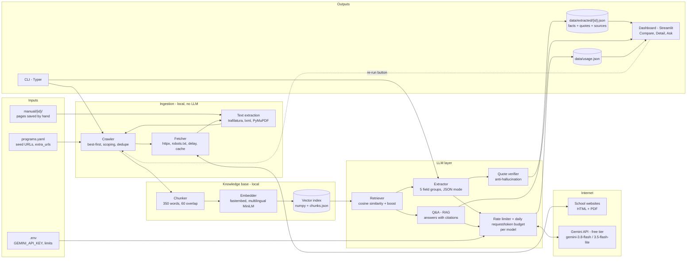
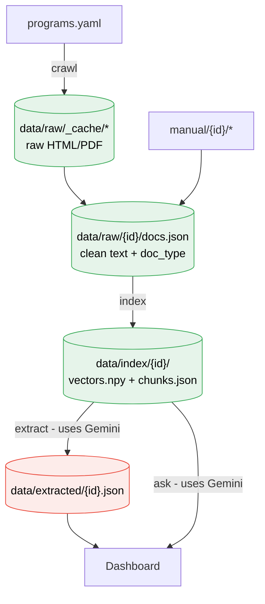
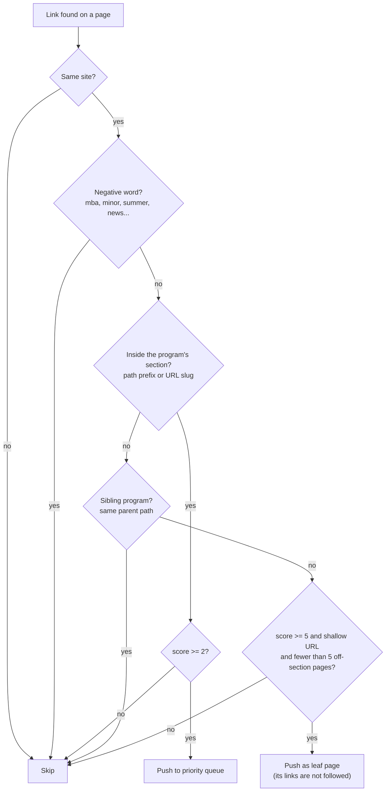
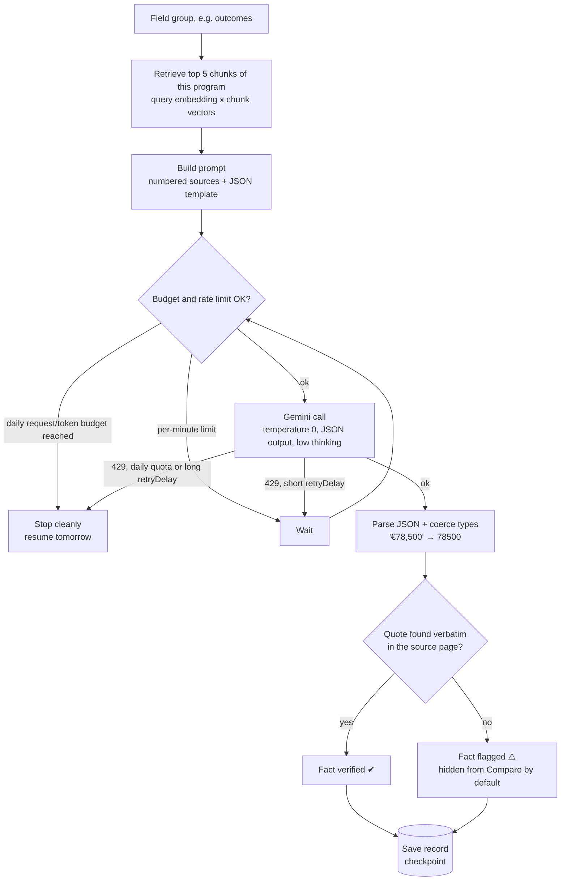
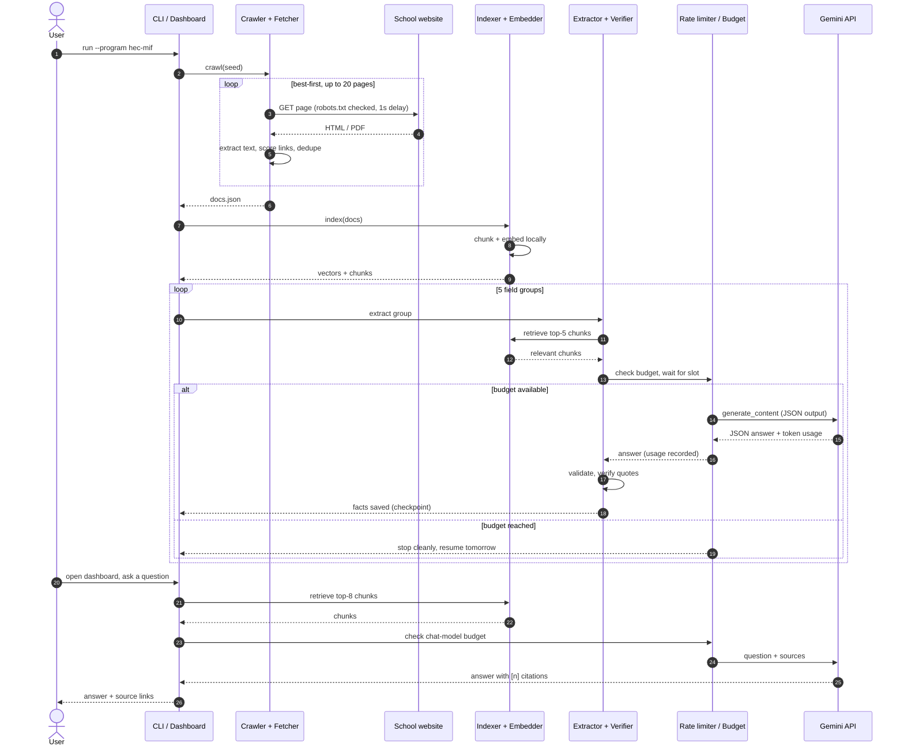

# Architecture

## 1. System overview

What talks to what. Everything except the Gemini API runs locally and is free.

## 2. Pipeline stages and data on disk

Every stage writes its output to disk, so later runs skip stages that are already done.

Green = free local steps. Red = uses the Gemini free quota.

## 3. Crawler decisions

How the crawler decides whether to follow a link.

## 4. Extracting one field group

## 5. Summarized sequence

A full run for one program, followed by a question in the dashboard.

